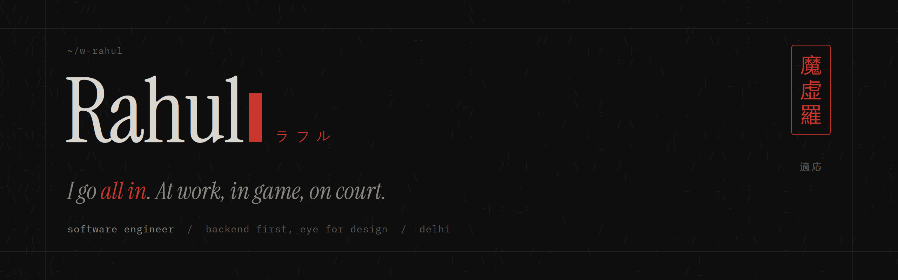
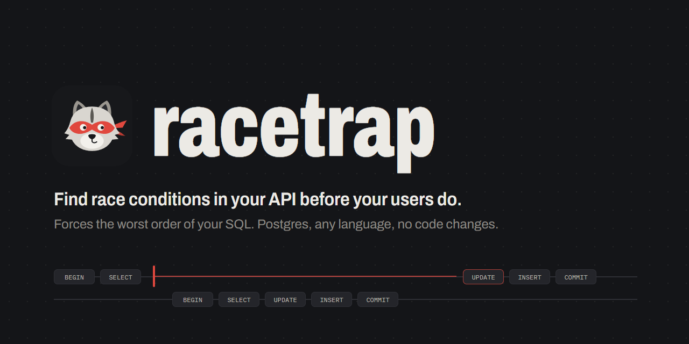

I got into code through games. First it was tweaking settings and breaking mods, then I cared more about how things worked than about playing them.

Now I build backend systems at Surepass: an LLM document platform, workflow engines, and billing on live traffic. I also design the parts people see.

### 作品 &nbsp;things I made

**[racetrap](https://github.com/w-rahul/racetrap)** finds race conditions in web APIs by forcing the worst order of their SQL statements. Open source, on PyPI as `racetrap`.

**[rxhxul.dev](https://rxhxul.dev)** is my portfolio, designed and built by hand.

### 連絡 &nbsp;find me

[rxhxul.dev](https://rxhxul.dev) &nbsp;/&nbsp; [x.com/rxhxul](https://x.com/rxhxul) &nbsp;/&nbsp; [linkedin](https://www.linkedin.com/in/rahul-gupta-b9a003259/) &nbsp;/&nbsp; [book a call](https://cal.com/rxhxul) &nbsp;/&nbsp; [rahulguptaji1019@gmail.com](mailto:rahulguptaji1019@gmail.com)
